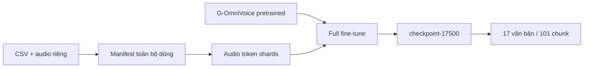

# Full fine-tune đến checkpoint-17500

Luồng chạy:

Mã training/model/codec lấy từ upstream; repo này cung cấp orchestration, kiểm tra dữ liệu và đánh giá đã phục hồi. Không có định nghĩa kiến trúc model viết lại trong repo.

## Recipe

| Tham số | Giá trị |
| --- | --- |
| Initialization | `g-group-ai-lab/g-omnivoice` |
| Phương thức | Full fine-tune, `use_lora=false` |
| Đích mặc định | 17.500 optimizer steps |
| Learning rate / weight decay | `1e-5` / `0.01` |
| Batch tokens / gradient accumulation | 8192 / 1 |
| Precision / attention | BF16 / FlexAttention |
| Warmup / seed | Ratio 0,01 / 42 |
| Checkpoint | Mỗi 500 bước, giữ tất cả |
| Dữ liệu | Train toàn bộ CSV, không dev |

Recipe được đọc từ [mã cấu hình v2](../scripts/training/make_train_config.py). Bản gốc đặt 5.000 bước; repo chọn 17.500 theo điểm kết thúc đã được xác nhận và đường dẫn trong [run config đánh giá](../reports/checkpoint-17500/run_config.json). Không có frozen config/launcher log train gốc để kiểm chứng mọi giá trị thực tế của run đó. Không quy đổi 17.500 bước sang số epoch khi thiếu số mẫu và batching thực tế.

## Các action

| Action | Tác dụng |
| --- | --- |
| `check` | Kiểm tra CSV, upstream source, Python/Accelerate và CUDA/BF16 |
| `download-model` | Tải initialization và codec; ghi Hub commit cho lần tải mới |
| `prepare` | Xuất manifest và các phần tokenize; không thay đổi CSV |
| `smoke` | Tokenize 256 mẫu đầu, train thử 10 bước ở output riêng |
| `tokenize` | Mã hóa toàn bộ manifest, kiểm tra đủ dòng |
| `start` | Train nền với cấu hình được lưu lại |
| `resume` | Chọn checkpoint có số bước lớn nhất, dùng lại frozen config |
| `status` | Hiển thị PID, checkpoint và log |
| `stop` | Gửi TERM cho process group do runner tạo |

Một GPU được dùng cho training (`accelerate --num_processes 1`). `GPU_IDS` dùng cho training/tokenization; `GPU_ID` dùng cho evaluation. Runner là công cụ chạy đơn, không phải bộ điều phối nhiều job: dùng output riêng và tránh chạy hai launcher đồng thời vào cùng thư mục.

Smoke không ghi đè output cũ. Nếu cần chạy lại, cấu hình `RUN_ROOT` mới cho smoke rồi trở lại output chính. Đọc log để xác nhận smoke đủ 10 bước trước khi chạy đầy đủ.

Resume cần cả checkpoint và trạng thái optimizer/scheduler tương ứng, cùng `frozen_train_config.json`/`frozen_data_config.json` tại run root. Một file weights đơn lẻ chỉ phục vụ nạp model khi có đủ cấu hình tương thích; nó không cung cấp trạng thái resume.

Khi bắt đầu run mới, runner giữ mọi checkpoint nên dung lượng tăng theo số lần lưu. Kiểm tra dung lượng ổ đĩa theo model và dữ liệu thực tế của bạn.
